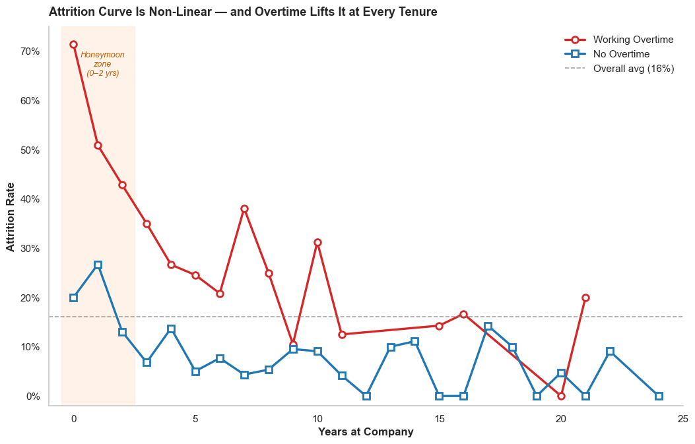
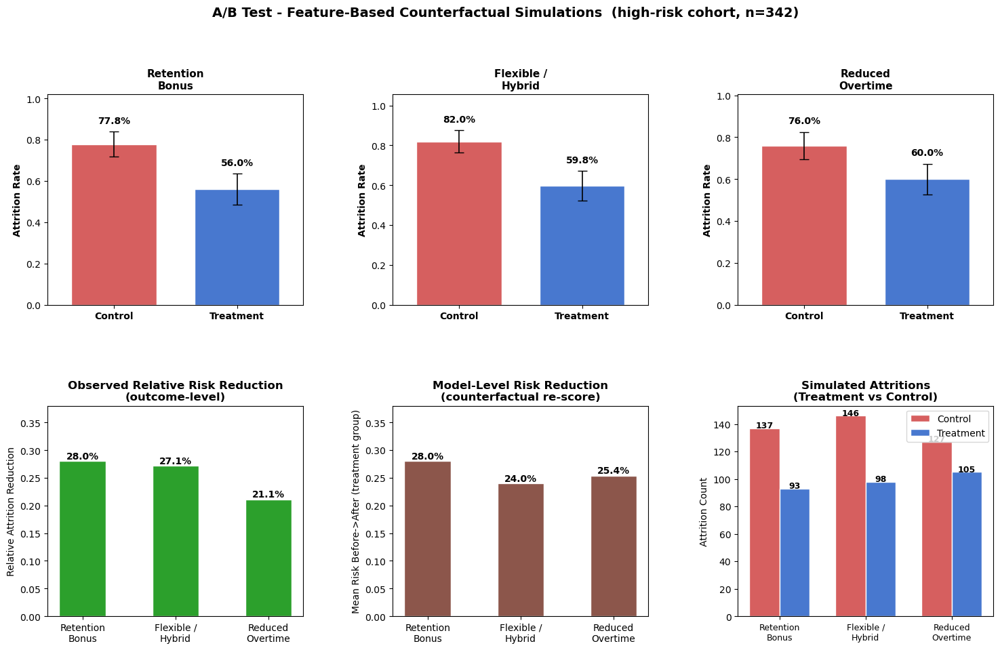

# HR Employee Attrition: Prediction & Intervention Analysis

An end-to-end machine-learning project that predicts which employees are most likely to leave a company and uses statistical testing to evaluate the projected impact of HR retention programs.

## TL;DR

- **Model:** Logistic Regression was the best of 5 classifiers (ROC-AUC 0.81). Tuning the decision threshold from 0.50 to 0.42 raised the share of leavers caught from **60% to 74%**.
- **Risk tiers:** employees scored High risk left at **49.1%**, versus **3.0%** in the Low tier (14.4% Medium).
- **Overtime:** employees working overtime left at **30.5% vs 10.4%** (about 3x), and the gap holds at almost every tenure.
- **Interventions:** simulated retention programs on the 342 high-risk employees cut predicted attrition by **21–28%**, with pilot sizes of 127–262 employees to confirm each one.



## Overview

Employee attrition is a costly problem: replacing a single employee can cost 50–200% of their annual salary in recruiting, onboarding, and lost productivity. This project takes IBM's published HR Analytics dataset and builds a complete pipeline — from data cleaning through modeling, explainability, and counterfactual A/B simulation — to answer two questions:

1. **Who is at risk?** Score every employee with a probability of attrition and segment the workforce into Low / Medium / High risk tiers.
2. **What should we do?** Simulate targeted intervention programs (e.g. reducing overtime, raising compensation, adjusting commute) and use proportion z-tests + power analysis to estimate which would move the needle.

## Dataset

[IBM HR Analytics Employee Attrition & Performance](https://www.kaggle.com/datasets/pavansubhasht/ibm-hr-analytics-attrition-dataset) — 1,470 employees, 35 features spanning demographics, role, compensation, satisfaction scores, tenure, and overtime.

The class balance is imbalanced (~16% attrition), which drives several modeling decisions downstream.

## Project Structure

```
hr-attrition/
├── data/
│   ├── WA_Fn-UseC_-HR-Employee-Attrition.csv   # raw IBM dataset
│   └── hr_attrition_clean.csv                  # cleaned export
├── notebook/
│   ├── 01_data.ipynb        # cleaning + feature engineering
│   ├── 02_eda.ipynb         # exploratory analysis
│   ├── 03_modeling.ipynb    # model training, tuning, explainability
│   └── 04_testing.ipynb     # A/B simulation + power analysis
├── requirements.txt
├── LICENSE
└── README.md
```

## Methodology

### 1. Data Preparation (`01_data.ipynb`)

- Drop zero-variance columns (`EmployeeCount`, `StandardHours`, `Over18`) and duplicates.
- Encode the binary target and `OverTime`; one-hot encode `BusinessTravel`, `Department`, `EducationField`, `Gender`, `JobRole`, `MaritalStatus`.
- Engineer features intended to capture relationships the raw columns miss:
  - `PromotionToTenureRatio`, `IncomePerYearAtCompany`
  - Tenure buckets (`0–2`, `3–5`, `6–10`, `10+` years)
  - Interaction terms such as `OverTime × JobSatisfaction` and `DistanceFromHome × OverTime`
- Map ordinal satisfaction/involvement scores to human-readable labels for EDA, while keeping numeric encodings for modeling.

### 2. Exploratory Analysis (`02_eda.ipynb`)

Visualizes class balance, attrition rates by department and job role, the overtime effect, distance-from-home distributions, tenure patterns, and a correlation heatmap of numeric features.

### 3. Modeling (`03_modeling.ipynb`)

Five candidate classifiers are trained on a stratified 80/20 split:

- Logistic Regression (class-balanced, scaled)
- Decision Tree
- Random Forest
- Gradient Boosting
- XGBoost

**Evaluation metrics:** ROC AUC and PR AUC (the right primary metrics for an imbalanced problem), F1, precision/recall.

**Threshold tuning:** the default 0.50 cutoff is suboptimal under class imbalance, so two data-driven thresholds are computed: the F1-maximizing threshold and the Youden's J statistic from the ROC curve.

**Explainability:**
- Native feature importances (or absolute coefficients for Logistic Regression)
- Permutation importance scored on ROC AUC (model-agnostic, captures interactions)
- SHAP values for global summary plots and local case explanations

**Risk scoring:** the winning model produces a probability for every employee, ranked and segmented into Low (<0.3), Medium (0.3–0.6), and High (>0.6) risk tiers — the artifact a real HR business partner would actually consume.

### 4. Intervention Testing (`04_testing.ipynb`)

This is the part that turns a model into a decision tool. For each hypothetical intervention program (e.g. "cap overtime for high-risk employees", "shift compensation for the bottom quartile"), the notebook:

1. Identifies the targeted population.
2. Counterfactually edits the relevant feature(s) and re-scores them through the trained model.
3. Compares baseline-vs-treatment attrition probability with a two-proportion z-test.
4. Runs power analysis (`statsmodels.NormalIndPower`) to estimate the sample size needed to detect the projected effect at α = 0.05, power = 0.80.

The output is a ranked list of programs with effect size, p-value, and required sample size — i.e., what to actually pilot first.



| Program | Simulated attrition (control → treatment) | Relative reduction | Pilot size needed (80% power) |
|---|:--:|:--:|:--:|
| Retention bonus | 77.8% → 56.0% | 28.0% | 143 |
| Flexible / hybrid schedule | 82.0% → 59.8% | 27.1% | 127 |
| Reduced overtime | 76.0% → 60.0% | 21.1% | 262 |

These are model-based simulations, not observed outcomes. The flexible-schedule and overtime programs change real features and re-score employees through the model; the retention bonus has no matching feature in the data, so its effect is an assumed 28% risk reduction. The table is a guide to which pilot to run first, not proof that a program works.

## Key Findings

- **Overtime is one of the strongest drivers.** Employees working overtime leave at 30.5% vs 10.4% for those who don't (about 3x), and overtime ranks second in permutation importance.
- **Tenure is non-linear.** Attrition is highest in the first two years, especially for employees working overtime (over 70% in year 0), then falls sharply.
- **Involvement, travel, and promotion gaps matter.** Job involvement, frequent business travel, work-life balance, and years since last promotion are among the top drivers in the model's coefficients and SHAP values.
- **The high-risk tier is where to act.** 342 employees (23% of the workforce) fall in the High tier, and 49.1% of them actually left — the right population for targeted retention programs.

## Tech Stack

- **Core:** Python 3.10+, pandas, NumPy
- **Modeling:** scikit-learn, XGBoost
- **Explainability:** SHAP, scikit-learn permutation importance
- **Statistics:** SciPy, statsmodels (proportion z-tests, power analysis)
- **Visualization:** matplotlib, seaborn
- **Environment:** Jupyter Notebook

## How to Run

```bash
# 1. Clone
git clone https://github.com/handillon1/hr-attrition.git
cd hr-attrition

# 2. Create and activate a virtual environment
python -m venv venv
source venv/bin/activate      # on Windows: venv\Scripts\activate

# 3. Install dependencies
pip install -r requirements.txt

# 4. Launch Jupyter and run the notebooks in order
jupyter notebook
```

Run the notebooks in the order `01 → 02 → 03 → 04`. Notebooks 3 and 4 depend on the pickled artifacts produced by the earlier notebooks, which are gitignored and regenerated on first run.

## Future Work

- Wrap the trained pipeline in a small Flask/FastAPI service so HR could submit an employee record and get back a risk score + top SHAP drivers.
- Replace the static intervention set with a search over feasible policies, using each employee's individual SHAP profile to recommend a *personalized* intervention rather than a population-wide one.
- Add fairness diagnostics (subgroup AUC, demographic parity gaps) so any deployed scoring system is audited against the obvious failure modes.

## License

This project is licensed under the MIT License — see [LICENSE](LICENSE).

The IBM HR Analytics dataset is a fictional, IBM-published dataset distributed for educational use.
